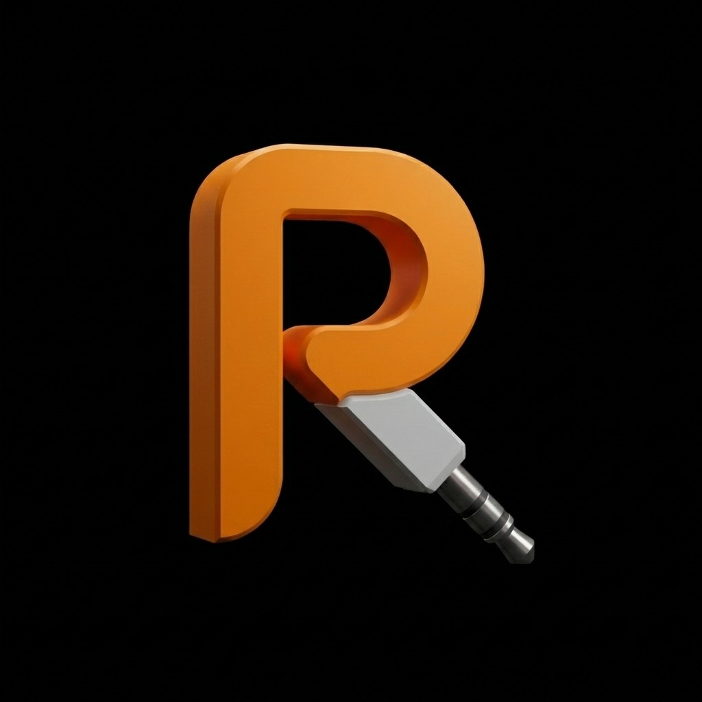
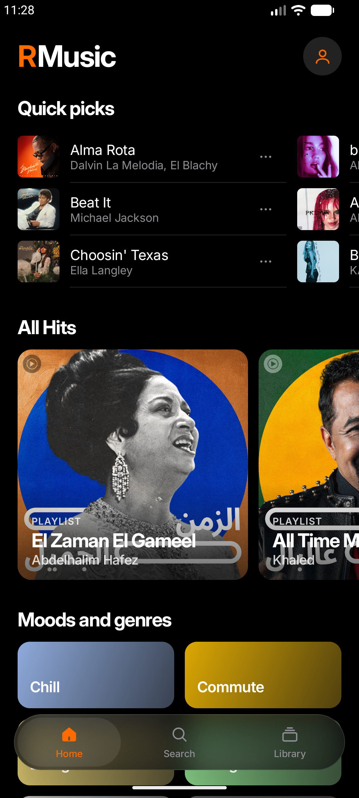
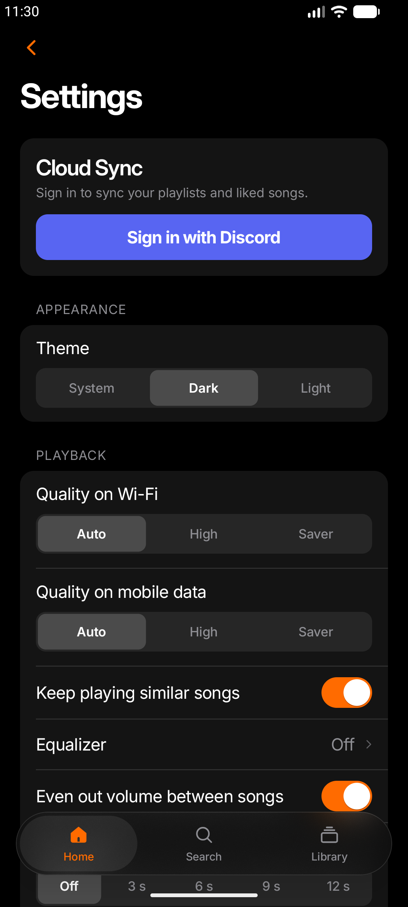
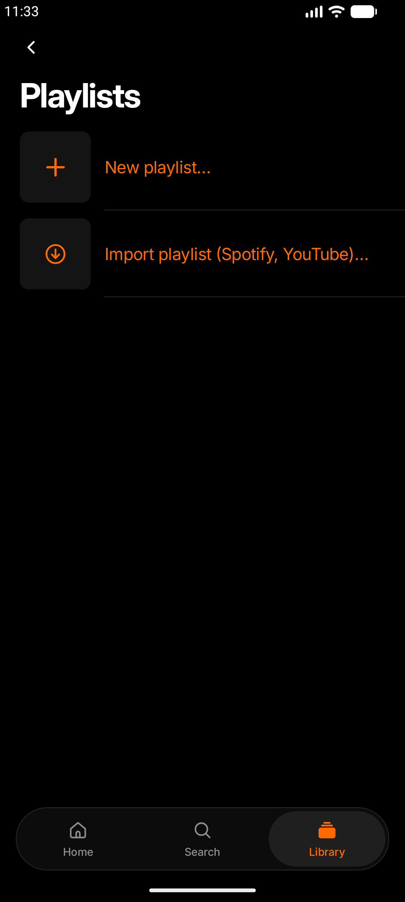

<div align="center">
  

  <br />

  <h1>⚡ RMusic (RM) ⚡</h1>

  <p>
    <strong>A high-performance, ad-free streaming & offline music app for Android.</strong><br>
    Pure OLED Black & Electric Orange • Instant Supabase Cloud Sync • Self-Hosted OTA Updates
  </p>

  <p>
    <a href="https://music.rayane.top"></a>
    <a href="https://music.rayane.top/RMusic.apk"></a>
    
    
    
  </p>
</div>

---

## ✨ Features & Highlights

- 🏎️ **Signature Rayane.top Design**: Pure `#000000` OLED carbon theme with electric orange (`#FF6B00`) accents and dynamic liquid water-wave shaders in the player backdrop.
- ⚡ **Instant Launch & Zero Latency**: No splash screen hang, immediate playback start, and zero tracker overhead.
- 🌐 **In-App Self-Hosted OTA Updater**: Automatically checks `https://music.rayane.top/rmusic-update.json` on startup. Push updates to all devices anytime without requiring users to hunt for downloads!
- 🎧 **Ad-Free Audio Streaming**: Background audio playback, lock screen media controls, notification actions, and unlimited caching.
- 🔄 **Real-Time Supabase Cloud Sync**: Instant bi-directional cloud backup for playlists, liked songs, and favorite artists via Discord OAuth.
- 💾 **Liked Songs Auto-Download**: Enable the `AUTO` toggle once on your Liked Songs playlist, and RMusic automatically downloads every track you like for offline listening.
- 📥 **Universal Playlist Importer**: Paste any Spotify or YouTube playlist link to instantly import tracks straight into your library without developer API keys.
- 🎤 **Synchronized Lyrics**: Line-by-line and word-by-word synced lyrics (LRCLIB), audio translations, and shareable lyric cards.
- 🎚️ **Pro Audio Enhancements**: Built-in 5-band Equalizer, crossfade up to 12s, and automatic loudness leveling.
- 🚗 **Android Auto**: Full in-car audio support and home screen widgets.

---

## 📸 Screenshots Gallery

<p align="center">
  
  
  
</p>

---

## 📲 Download & Installation

You can get the latest APK directly from our official web hub:

1. Download **[`RMusic.apk`](https://music.rayane.top/RMusic.apk)** from **[music.rayane.top](https://music.rayane.top)**.
2. Open the APK on your Android device (Android 9.0+).
3. If prompted, tap *Allow from this source*.
4. All future updates can be installed with one tap directly inside the app!

---

## 🚀 Building from Source

### Prerequisites
- JDK 17 or JDK 21+
- Android SDK (API 34+ / 36 build-tools)

```bash
# Clone the repository
git clone https://github.com/zirharayane/RMusic.git
cd RMusic

# Build debug APK
./gradlew :app:assembleDebug

# Install directly to connected device or emulator
adb install -r app/build/outputs/apk/debug/app-debug.apk
```

---

## 🗄️ Supabase Cloud Setup

To enable real-time cloud sync for your users:
1. Open your project on the [Supabase Dashboard](https://supabase.com/dashboard).
2. Go to **SQL Editor** -> **New Query**.
3. Paste the contents of [`supabase_schema.sql`](./supabase_schema.sql) and click **Run**.
4. In **Authentication -> Providers**, enable **Discord** with your Discord Client ID and Secret.

---

## 🌐 Official Web Portal

The web showcase and OTA update server source code is located at:
- **Repository**: [`zirharayane/RMusic-web`](https://github.com/zirharayane/RMusic-web)
- **Live Portal**: [https://music.rayane.top](https://music.rayane.top)

---

## 📄 Credits & Attribution

RMusic is powered by the open-source community:
- [Metrolist](https://github.com/mostafa-a-al/metrolist) & [innertubex](https://github.com/mostafa-a-al/innertubex) for YouTube Music API mapping.
- [LRCLIB](https://lrclib.net/) and [LyricsPlus](https://github.com/surfbouncer/lyricsplus) for synced lyrics.
- [Haze](https://github.com/chrisbanes/haze) for frosted glass blur effects.
- [SponsorBlock](https://sponsor.ajay.app/) for optional segment skipping.

---

<p align="center">
  Crafted with care by <strong>Rayane</strong>
</p>
