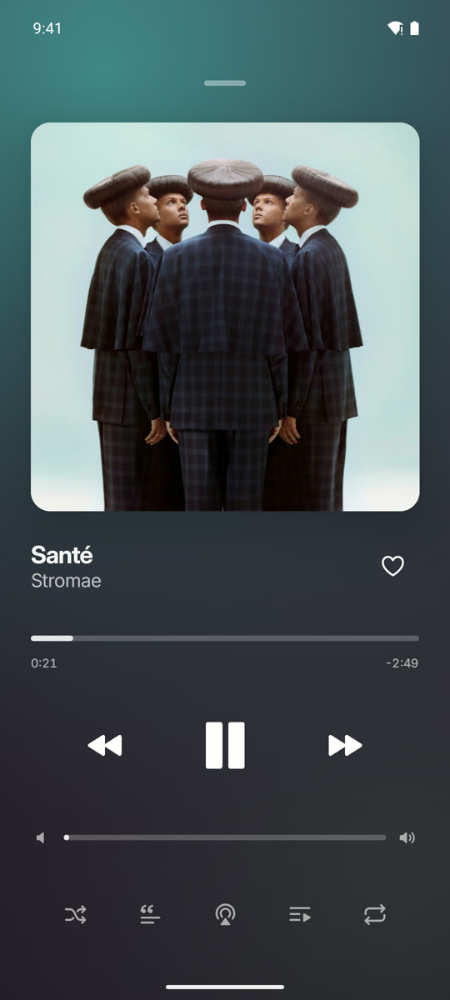
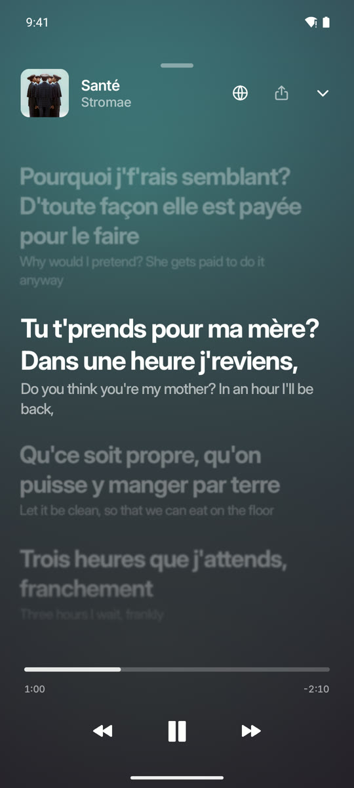
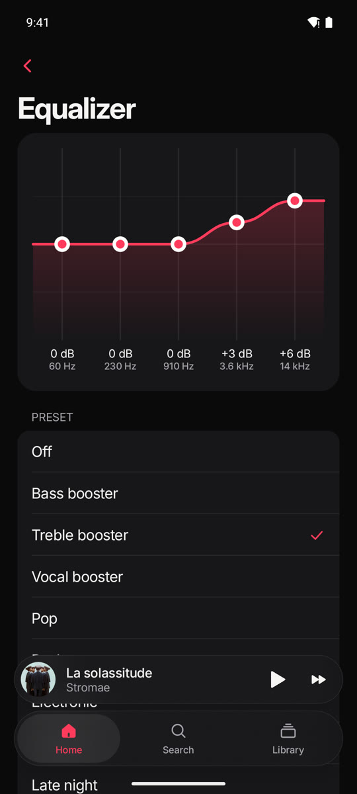
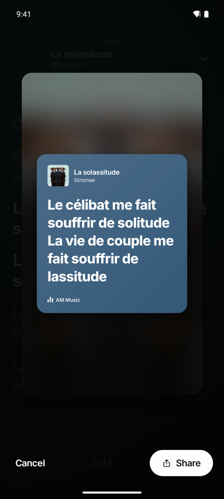

<p align="center">
  
</p>

<h1 align="center">RMusic (RM)</h1>

<p align="center">
  <strong>A fast, sleek, ad-free music streaming app for Android.</strong><br>
  Built with Jetpack Compose & Kotlin • OLED Black & Electric Orange • Supabase Cloud Sync
</p>

<p align="center">
  <a href="https://github.com/zirharayane/RMusic/releases/latest"></a>
  
  
  
</p>

---

## ⚡ Highlights

- 🍊 **Signature Rayane.top Design**: Pure `#000000` OLED carbon theme with electric orange accents and ultra-responsive custom Compose UI.
- 🚀 **Instant Launch**: Optimized launch experience with zero splash lag.
- ☁️ **Discord Cloud Sync**: Connect with Discord to automatically sync your playlists and liked songs to the cloud via Supabase.
- 📥 **Playlist Importer**: Import public Spotify playlists or YouTube playlists straight into your library without needing developer API keys.
- 🎵 **Ad-Free Audio Streaming**: Clean, uninterrupted background playback, lock screen controls, and notification drawer media sessions.
- 🎤 **Time-Synced Lyrics**: Line-by-line and word-by-word synced lyrics with translations, plus shareable lyric cards.
- 💾 **Offline Listening**: Unlimited audio caching and one-tap **Download All** for songs, albums, and playlists.
- 🎚️ **Audio Enhancements**: Built-in 5-band Equalizer, crossfade up to 12s, and automatic loudness volume leveling.
- 🚗 **Android Auto**: Full Android Auto in-car support and home screen widgets.

---

## 📱 Screenshots

<p align="center">
  
  
  
</p>

<p align="center">
  
  
  
  
</p>

---

## 📥 Installation

Grab the latest APK directly from the **[Releases](https://github.com/zirharayane/RMusic/releases)** page:

1. Download **`RMusic.apk`**.
2. Open the APK on your Android device (Android 9.0+ required).
3. If prompted, allow *Install unknown apps* for your browser or file manager.

---

## 🛠️ Building from Source

### Prerequisites
- JDK 17 or JDK 21+
- Android SDK (API 34+ recommended)

```bash
# Clone the repository
git clone https://github.com/zirharayane/RMusic.git
cd RMusic

# Build debug APK
./gradlew :app:assembleDebug

# Install directly to a connected device or emulator
adb install -r app/build/outputs/apk/debug/app-debug.apk
```

---

## 🔒 Privacy & Permissions

- **Zero Ads & Zero Tracking**: No analytics trackers, no ad networks.
- **Direct Streaming**: All stream audio queries run directly through YouTube Music endpoints.
- **Secure Cloud Sync**: Cloud authentication is handled through Discord OAuth via Supabase without storing passwords.

---

## 📜 Credits & Acknowledgments

RMusic builds upon open-source contributions from the Android and music communities:
- [Metrolist](https://github.com/mostafa-a-al/metrolist) & [innertubex](https://github.com/mostafa-a-al/innertubex) for YouTube Music API mapping.
- [LRCLIB](https://lrclib.net/) and [LyricsPlus](https://github.com/surfbouncer/lyricsplus) for synced lyrics.
- [Haze](https://github.com/chrisbanes/haze) for frosted glass blur effects.
- [SponsorBlock](https://sponsor.ajay.app/) for optional sponsor segment skipping.
